  <picture>
    <source media="(prefers-color-scheme: dark)" srcset="assets/wordmark-plain-on-dark.svg">
    
  </picture>

<b>You get the fix, not the alert.</b>

  

Every codebase pays a maintenance tax. We pay it for you.

When an API your code depends on changes, patch-it finds the exact lines it breaks and opens a pull request with the fix. Stripe removes a parameter, OpenAI shuts down a model, Anthropic retires a version: you wake up to a PR, not a production incident.

### How it works

| | |
|---|---|
|  | **It runs while you sleep.** A GitHub Action in your CI checks the APIs you list, on a schedule. |
|  | **It finds the exact lines.** Only code that actually calls the changed API; an Azure deployment named `gpt-4` is left alone. |
|  | **You review and merge.** A small pull request, with the source of the change linked. If it isn't sure, it opens an issue instead. |

Your code never leaves your CI, and it runs on your own model key.

### Proof

Six maintainers we'd never met have merged patch-it's pull requests (6 of 23 opened, median 1.5 days to merge, as of 2026-10-28).

### Links

[patch-it.dev](https://patch-it.dev) · docs at [docs.patch-it.dev](https://docs.patch-it.dev)

Got fixed by patch-it? Add the badge: 

[^^] patch-it · the night shift for your dependencies
